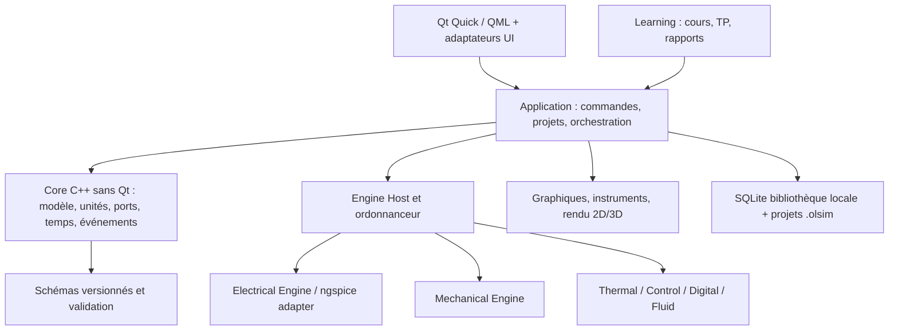

# Architecture proposée

## Objectif et non-objectifs

Les étapes 0 et 1 fixent la structure et les contrats, pas un simulateur commercial complet. Le premier vertical fonctionnel sera le banc moteur CC, mais son moteur numérique est hors de cette étape. Le projet ne cherchera pas à réimplémenter d’un coup Proteus, SolidWorks et Wokwi : il développera une plateforme composable, avec des domaines et solveurs ajoutés progressivement.

## Couches et dépendances



Règle de dépendance : l’interface dépend des services applicatifs ; le Core décrit les données et contrats métier/scientifiques ; les moteurs implémentent des adaptateurs vers ces contrats. Aucun moteur ne dépend de QML ni ne dessine directement sa sortie.

## Arborescence cible

```text
OpenLabSimulator/
├── AGENTS.md
├── README.md
├── app/                         # démarrage, composition, commandes
├── core/                        # domaine C++ sans Qt, unités, graph, temps
├── engines/
│   ├── common/                  # contrats runtime, résultats et diagnostics
│   ├── electrical/              # backend SPICE et modèles complémentaires
│   ├── mechanical/
│   ├── thermal/
│   ├── control/
│   ├── digital/
│   └── fluid/
├── integrations/                # adaptateurs ngspice, FMI, import/export
├── plugin-api/                  # manifeste et protocole versionnés
├── instruments/                 # acquisition des résultats, vues instruments
├── visualization/
│   ├── schematic2d/             # éditeur schématique
│   ├── scene3d/                 # abstractions scène et backend
│   ├── graphs/
│   └── animation/
├── library/
│   ├── schemas/                 # schémas de composants déclaratifs
│   ├── components/
│   ├── models/
│   ├── assets3d/
│   └── experiments/
├── education/                   # cours, TP, évaluations, rapports
├── interface/                   # QML, thème, ressources UI
├── data/                        # migrations de bibliothèques locales
├── tests/                       # unitaires, intégration, références
├── docs/                         # architecture, modèle, validation, ADR
├── THIRD_PARTY_NOTICES/
├── CMakeLists.txt
└── CMakePresets.json
```

L’arborescence de code sera matérialisée à l’étape 2. Les dossiers de modules non livrés restent absents plutôt que remplis de squelettes décoratifs.

## Contrats essentiels

- **ComponentDefinition** : identifiant stable et version, domaine, ports typés, unités/signaux, paramètres avec contraintes, provenance, modèle/version, asset refs/licences, doc et exigences de validation.
- **Project** : graphe d’instances/connections + configuration, ressources référencées, état d’édition et historique de migration ; résultats volumineux optionnels.
- **PhysicalQuantity** : valeur numérique, unité SI/échelle, statut et provenance ; les valeurs non finies ou unités inconnues sont rejetées aux frontières.
- **SimulationEngine** : `configure → initialize → advance/run → collect → reset`, avec annulation, diagnostics structurés, capacités déclarées (temps fixe/variable, événements, domaines couplés) et erreurs typées.
- **Results** : signaux horodatés, unité, port/source, moteur/config/version, niveau d’incertitude si fourni ; instruments consomment ces échantillons via des canaux de données.
- **App services** : ouvrir/sauver projet, connecter composants, configurer simulation, démarrer/arrêter, interroger résultats. La UI ne touche pas directement à une bibliothèque SPICE.

## Qt et rendu

Qt 6/QML est un candidat d’interface native multiplateforme. Qt Quick gère l’interface et le rendu de scène UI ; les graphes et l’éditeur 2D doivent rester légers et virtualisés. Le rendu 3D passe par une frontière `SceneRenderer`, qui permet d’échanger backend et qualité. Ne pas imposer OpenGL au Core : Qt s’appuie sur des abstractions de rendu selon plateforme, et l’API OpenGL directe augmente les contraintes de compatibilité.

Le choix précis du module 3D est soumis à la licence et aux performances. Qt Quick 3D est GPL pour la Community Edition selon la matrice Qt actuelle ; le modèle Open Core impose de vérifier une licence commerciale compatible, ou de choisir un backend alternatif permissif avant son intégration. Démarrer avec une vue de scène simple, LOD, framerate adaptatif et animation calculée.

## Extension et sécurité

Les premières extensions seront des composants déclaratifs validés (JSON Schema) et des moteurs intégrés au programme. Une ABI C++ de plugins tiers est fragile entre compilateurs/versions Qt. L’API future devra être versionnée et de préférence transportable via IPC pour isoler crashs et dépendances. Chaque manifeste déclare compatibilité, capacités, licence, permissions et hash/signature de distribution. Un plugin local ne s’exécute qu’après action explicite ; le cloud n’est pas requis.

## Données locales et pédagogie

SQLite indexe la bibliothèque, les métadonnées de ressources, la progression et les cours locaux. Les projets portables restent dans `.olsim`, et non dans une base globale. Les expériences pédagogiques sont des contenus versionnés associant objectifs, montage initial, instructions, critères et références scientifiques ; elles ne peuvent pas dissimuler des valeurs simulées.

## Contraintes de l’ordinateur de développement

Intel HD 520 et CPU 2C/4T imposent scènes raisonnables, compilation parallèle plafonnée, solveurs déplacés du thread UI et qualité 3D graduée. Le matériel ne prouve pas les performances sur d’autres machines ; un benchmark de scène et de solveur devra établir les seuils.
